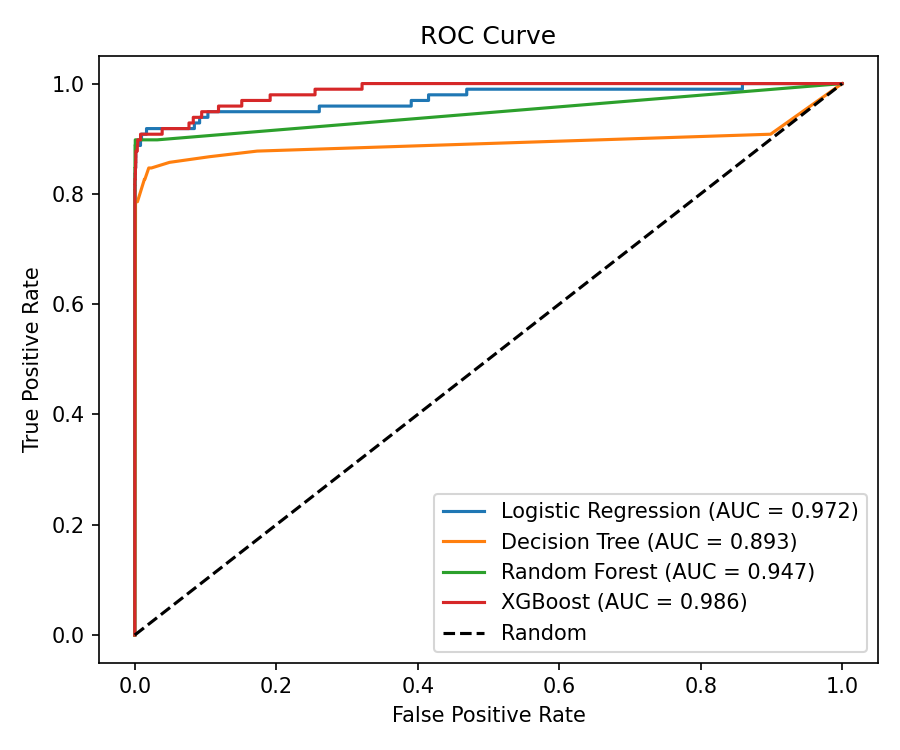
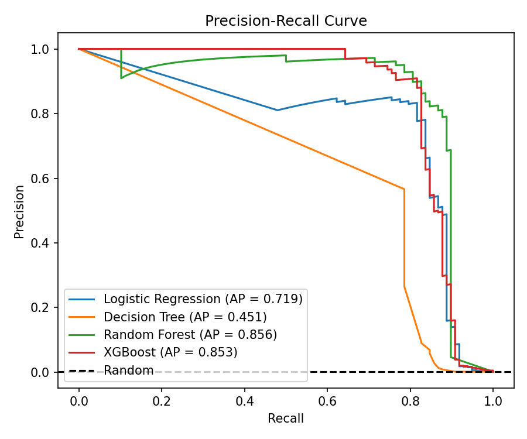

# Credit Card Fraud Detection

Machine learning project to detect fraudulent credit card transactions using **Logistic Regression**, **Decision Tree**, **Random Forest** and **XGBoost** on a highly imbalanced dataset.

## Dataset

[Kaggle: Credit Card Fraud Detection](https://www.kaggle.com/datasets/mlg-ulb/creditcardfraud) (ULB Machine Learning Group)

- 284,807 transactions made by European cardholders in September 2013
- Only 492 frauds (about 0.17%), so the data is extremely imbalanced
- Features `V1` to `V28` are PCA-transformed (anonymised), plus `Time`, `Amount` and the target `Class` (1 = fraud, 0 = legitimate)

The dataset is not included in this repo because of its size. Download `creditcard.csv` and place it in the project root.

## Approach

1. Loaded the data and scaled `Amount` and `Time` with `StandardScaler`
2. Stratified 80/20 train-test split, so the fraud ratio is preserved in both sets
3. Trained four models, each with imbalance handling:
   - Logistic Regression (`class_weight="balanced"`)
   - Decision Tree (`class_weight="balanced"`, `max_depth=6`)
   - Random Forest (100 trees, `class_weight="balanced_subsample"`)
   - XGBoost (200 trees, `scale_pos_weight` set to the legit:fraud ratio)
4. Evaluated with the confusion matrix, precision, recall, F1, ROC-AUC and Average Precision (PR-AUC). Accuracy is not used as the main metric because a model that predicts "not fraud" every time would score about 99.8%.

## Results

Test set: 56,962 transactions, of which 98 are fraud.

| Model | Fraud Recall | Fraud Precision | F1 (Fraud) | ROC-AUC | Avg Precision |
|---|---|---|---|---|---|
| Logistic Regression | 0.918 | 0.061 | 0.114 | 0.972 | 0.719 |
| Decision Tree | 0.847 | 0.059 | 0.109 | 0.893 | 0.451 |
| Random Forest | 0.765 | **0.949** | **0.848** | 0.947 | **0.856** |
| XGBoost | 0.837 | 0.626 | 0.716 | **0.986** | 0.853 |

**Confusion matrices**

| | Logistic Regression | Decision Tree | Random Forest | XGBoost |
|---|---|---|---|---|
| True Negatives | 55,475 | 55,527 | 56,860 | 56,815 |
| False Positives | 1,389 | 1,337 | 4 | 49 |
| False Negatives | 8 | 15 | 23 | 16 |
| True Positives | 90 | 83 | 75 | 82 |

### Key Takeaways

- **Random Forest and XGBoost clearly outperform the simpler models.** Their Average Precision (0.856 and 0.853) is far above Logistic Regression (0.719) and the Decision Tree (0.451).
- **Random Forest is the most precise**: only 4 false alarms across 56,864 legitimate transactions, with 95% of flagged transactions being real fraud. It misses more fraud (23 of 98).
- **XGBoost has the best ROC-AUC (0.986)** and catches more fraud than Random Forest (82 vs 75) at the cost of more false alarms (49 vs 4).
- **Logistic Regression has the highest recall (0.918)** but flags about 1,400 legitimate transactions to get it, so its precision is only 6%. This is the usual recall vs precision trade-off in fraud detection.
- Random Forest and XGBoost are very close on Average Precision (0.856 vs 0.853). With only 98 fraud cases in the test set, this gap is too small to call a clear winner.
- **Accuracy is misleading** on imbalanced data (all four models score above 97%), so recall, precision and PR-AUC are used instead.

### Curves




ROC can look overly optimistic on heavily imbalanced data. The precision-recall curve is more informative here, and its random baseline is only about 0.0017 (the fraud rate).

## Tech Stack

- Python 3
- pandas
- scikit-learn
- XGBoost
- matplotlib

## Project Structure

```
credit-card-fraud-detection/
├── plots/
│   ├── roc_curve.png
│   └── precision_recall_curve.png
├── fraud_detection.py
├── requirements.txt
├── .gitignore
└── README.md
```

## How to Run

```bash
# 1. Clone the repository
git clone https://github.com/arpiitaaa/credit-card-fraud-detection.git
cd credit-card-fraud-detection

# 2. Install dependencies
pip install -r requirements.txt

# 3. Download creditcard.csv from Kaggle and place it in this folder

# 4. Run
python fraud_detection.py
```

## Future Improvements

- Try SMOTE / undersampling and compare with class weighting
- Tune the decision threshold using the precision-recall curve
- Hyperparameter tuning and cross-validation for Random Forest and XGBoost
- Add feature importance / SHAP explanations

## Author

**Arpita Srivastava**
